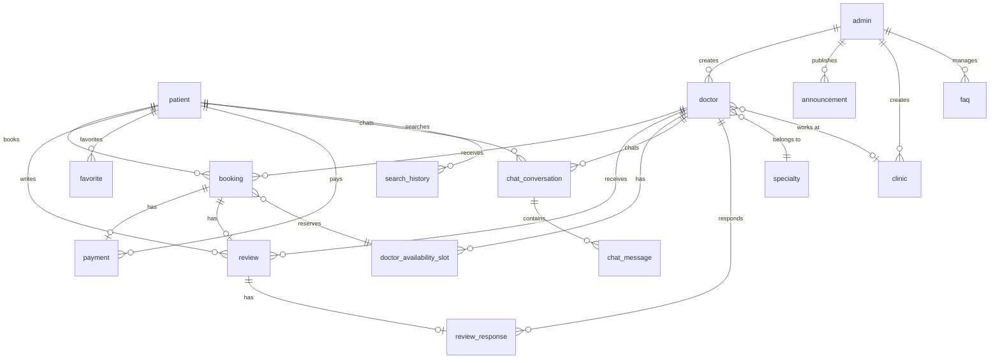

# 🏥 Doctor Booking App

A production-ready medical appointment booking platform built with **.NET 10** using **Clean Architecture**, **Vertical Slice Architecture**, **CQRS**, and **Domain-Driven Design**.

---

## 📐 Architecture Overview

This project follows a strict **4-layer Clean Architecture** with an inward dependency rule — outer layers depend on inner layers, never the reverse.

```
┌─────────────────────────────────────────────────┐
│                  API Layer                      │  ← Entry point (Controllers, Middleware)
│              (DoctorBooking)                    │
├─────────────────────────────────────────────────┤
│            Infrastructure Layer                 │  ← External concerns (DB, JWT, BCrypt)
│             (Infrastructure)                    │
├─────────────────────────────────────────────────┤
│            Application Layer                    │  ← Business logic (CQRS Handlers, Validators)
│              (Application)                      │
├─────────────────────────────────────────────────┤
│              Domain Layer                       │  ← Pure entities (zero dependencies)
│               (Domain)                          │
└─────────────────────────────────────────────────┘
```

### Dependency Flow (Strict)

```
Domain ← Application ← Infrastructure ← API
```

- **Domain** references **nothing** — pure C# POCOs
- **Application** references only **Domain**
- **Infrastructure** references **Application** (to implement its interfaces)
- **API** references **Application** + **Infrastructure** (for DI wiring)

---

## 🗂️ Project Structure

```
DoctorBookingApp.slnx
│
├── Domain/                                    # Layer 0: Domain Entities
│   ├── Domain.csproj                          # ZERO NuGet packages
│   └── Models/
│       ├── patient.cs                         # Pure POCO — no EF Core attributes
│       ├── doctor.cs
│       ├── admin.cs
│       ├── booking.cs
│       ├── clinic.cs
│       ├── specialty.cs
│       ├── review.cs
│       ├── review_response.cs
│       ├── announcement.cs
│       ├── chat_conversation.cs
│       ├── chat_message.cs
│       ├── doctor_availability_slot.cs
│       ├── faq.cs
│       ├── favorite.cs
│       ├── notification.cs
│       ├── notification_preference.cs
│       ├── payment.cs
│       ├── search_history.cs
│       └── system_log.cs
│
├── Application/                               # Layer 1: Business Logic
│   ├── Application.csproj                     # MediatR, FluentValidation, AutoMapper
│   ├── DependencyInjection.cs                 # AddApplication() extension
│   │
│   ├── Common/
│   │   ├── Interfaces/
│   │   │   ├── IApplicationDbContext.cs        # DB abstraction (DbSet<T> only)
│   │   │   ├── ITokenService.cs                # JWT generation contract
│   │   │   ├── IPasswordHasher.cs              # Hash/Verify contract
│   │   │   └── ICurrentUserService.cs          # Authenticated user claims
│   │   │
│   │   ├── Models/
│   │   │   ├── ApiResponse.cs                  # Standard API envelope
│   │   │   └── PagedResult.cs                  # Pagination wrapper
│   │   │
│   │   ├── Exceptions/
│   │   │   ├── ValidationException.cs          # Thrown by pipeline
│   │   │   └── NotFoundException.cs            # Thrown by handlers
│   │   │
│   │   ├── Behaviors/
│   │   │   └── ValidationBehavior.cs           # MediatR pipeline behavior
│   │   │
│   │   └── Mappings/
│   │       └── MappingProfile.cs               # AutoMapper entity → DTO maps
│   │
│   └── Features/
│       ├── Auth/                               # Authentication vertical slice
│       │   ├── DTOs/AuthResponse.cs
│       │   └── Commands/
│       │       ├── Register/                   # Command + Validator + Handler
│       │       ├── Login/                      # Command + Validator + Handler
│       │       ├── RefreshToken/               # Command + Handler
│       │       └── RevokeToken/                # Command + Handler
│       │
│       ├── Patients/                           # Patient management slice
│       │   ├── DTOs/PatientResponse.cs
│       │   ├── Queries/
│       │   │   ├── GetCurrentPatient/
│       │   │   ├── GetPatientById/
│       │   │   └── GetAllPatients/             # With pagination
│       │   └── Commands/
│       │       ├── UpdatePatient/              # Command + Validator + Handler
│       │       └── DeletePatient/              # Soft delete
│       │
│       └── Admins/                             # Admin management slice
│           ├── DTOs/AdminResponse.cs
│           ├── Queries/
│           │   ├── GetAllAdmins/
│           │   └── GetAdminById/
│           └── Commands/
│               ├── CreateAdmin/                # Command + Validator + Handler
│               ├── UpdateAdmin/                # Command + Validator + Handler
│               └── DeleteAdmin/                # Hard delete
│
├── Infrastructure/                            # Layer 2: External Concerns
│   ├── Infrastructure.csproj                  # EF Core, BCrypt, JWT Bearer
│   ├── DependencyInjection.cs                 # AddInfrastructure() extension
│   ├── Persistence/
│   │   ├── AppDbContext.cs                    # Implements IApplicationDbContext
│   │   └── Migrations/                        # EF Core migrations
│   └── Services/
│       ├── TokenService.cs                    # JWT generation (implements ITokenService)
│       ├── PasswordHasher.cs                  # BCrypt (implements IPasswordHasher)
│       └── CurrentUserService.cs              # Claims extraction (implements ICurrentUserService)
│
├── DoctorBooking/                             # Layer 3: API Entry Point
│   ├── DoctorBooking.csproj                   # Swagger, OpenAPI
│   ├── Program.cs                             # Slim — just DI + middleware pipeline
│   ├── Middleware/
│   │   └── GlobalExceptionHandlerMiddleware.cs
│   ├── Controllers/
│   │   ├── AuthController.cs                  # Thin — ISender only
│   │   ├── PatientsController.cs              # Thin — ISender only
│   │   └── AdminsController.cs                # Thin — ISender only
│   └── appsettings.json
│
└── Tests/                                     # Unit Test Project
    ├── Tests.csproj                           # xUnit, Moq, FluentAssertions
    ├── Common/
    │   ├── TestBase.cs                        # In-memory DB + mocked services
    │   ├── ValidationBehaviorTests.cs
    │   └── AutoMapperProfileTests.cs
    └── Features/
        ├── Auth/
        │   ├── RegisterCommandTests.cs
        │   ├── LoginCommandTests.cs
        │   ├── TokenCommandTests.cs
        │   └── AuthValidatorTests.cs
        ├── Patients/
        │   └── PatientHandlerTests.cs
        └── Admins/
            └── AdminHandlerTests.cs
```

---

## 🧩 Core Design Patterns

### 1. CQRS (Command Query Responsibility Segregation)

Every operation is either a **Command** (writes data) or a **Query** (reads data). They are separate classes dispatched via **MediatR**.

```csharp
// Query — read-only, no side effects
public sealed record GetPatientByIdQuery(long Id)
    : IRequest<ApiResponse<PatientResponse>>;

// Command — writes data, has side effects
public sealed record RegisterCommand(
    string FullName, string Email, string MobileNumber,
    string Password, string ConfirmPassword
) : IRequest<ApiResponse<AuthResponse>>;
```

### 2. Vertical Slice Architecture

Each feature is a self-contained folder with its own Command/Query, Validator, Handler, and DTOs. No shared "services" layer — each slice owns its entire stack.

```
Features/Auth/Commands/Register/
├── RegisterCommand.cs           ← The request (input DTO)
├── RegisterCommandValidator.cs  ← FluentValidation rules
└── RegisterCommandHandler.cs    ← Business logic
```

### 3. MediatR Pipeline

Every request flows through this pipeline before reaching its handler:

```
Controller → ISender.Send(command)
    │
    ▼
┌───────────────────────────┐
│   ValidationBehavior<T>   │  ← Runs FluentValidation validators
│   (Pipeline Behavior)     │  ← Throws ValidationException if invalid
└───────────┬───────────────┘
            │ (only if validation passes)
            ▼
┌───────────────────────────┐
│   CommandHandler<T>       │  ← Actual business logic
│   (Feature Handler)       │
└───────────────────────────┘
```

### 4. AutoMapper

All entity-to-DTO conversions are centralized in `MappingProfile.cs`:

```csharp
CreateMap<patient, PatientResponse>()
    .ForMember(d => d.Id, opt => opt.MapFrom(s => s.id))
    .ForMember(d => d.FullName, opt => opt.MapFrom(s => s.full_name));
```

Handlers inject `IMapper` and call `_mapper.Map<PatientResponse>(entity)`.

### 5. Standardized API Response

Every endpoint returns the same envelope format:

```json
{
    "success": true,
    "message": "Login successful.",
    "data": {
        "accessToken": "eyJhbG...",
        "refreshToken": "abc123...",
        "expiresAt": "2026-06-30T19:00:00Z",
        "patient": { "id": 1, "fullName": "John Doe", ... }
    },
    "errors": null
}
```

On failure:

```json
{
    "success": false,
    "message": "Validation failed.",
    "data": null,
    "errors": [
        "Email is required.",
        "Password must be at least 8 characters."
    ]
}
```

---

## 🛡️ Security

### JWT Authentication

- **Access Token** — Short-lived (60 min), sent via `Authorization: Bearer <token>`
- **Refresh Token** — Long-lived (7 days), stored in DB, used to rotate access tokens
- **Revocation** — `POST /api/auth/revoke` clears the refresh token (logout)

### Password Security

- Passwords hashed with **BCrypt** (cost factor 10)
- Hash operation isolated in `Infrastructure/Services/PasswordHasher.cs`
- Application layer never sees raw hashing — only the `IPasswordHasher` interface

### Configuration (`appsettings.json`)

```json
{
    "ConnectionStrings": {
        "DefaultConnection": "Server=...;Database=CureDB;..."
    },
    "JwtSettings": {
        "SecretKey": "YourSuperSecretKeyThatIsAtLeast32CharactersLong!",
        "Issuer": "DoctorBookingApp",
        "Audience": "DoctorBookingApp",
        "AccessTokenExpirationMinutes": 60,
        "RefreshTokenExpirationDays": 7
    }
}
```

---

## 📡 API Endpoints

### Auth

| Method | Endpoint | Auth | Description |
|--------|----------|------|-------------|
| POST | `/api/auth/register` | ❌ | Register new patient |
| POST | `/api/auth/login` | ❌ | Login with email/password |
| POST | `/api/auth/refresh` | ❌ | Refresh access token |
| POST | `/api/auth/revoke` | ✅ | Revoke refresh token (logout) |

### Patients

| Method | Endpoint | Auth | Description |
|--------|----------|------|-------------|
| GET | `/api/patients/me` | ✅ | Get current patient profile |
| PUT | `/api/patients/me` | ✅ | Update current patient profile |
| GET | `/api/patients` | ✅ Admin | Get all patients (paginated) |
| GET | `/api/patients/{id}` | ✅ Admin | Get patient by ID |
| DELETE | `/api/patients/{id}` | ✅ Admin | Soft-delete patient |

### Admins

| Method | Endpoint | Auth | Description |
|--------|----------|------|-------------|
| GET | `/api/admins` | ❌ | Get all admins |
| GET | `/api/admins/{id}` | ❌ | Get admin by ID |
| POST | `/api/admins` | ❌ | Create new admin |
| PUT | `/api/admins/{id}` | ❌ | Update admin |
| DELETE | `/api/admins/{id}` | ❌ | Delete admin |

---

## 🗃️ Database

### Entity Relationship Diagram



### Schema Configuration

All database constraints are defined via **Fluent API** in `AppDbContext.OnModelCreating()`:

- **Unique indexes**: `UQ_users_email`, `UQ_doctors_email`, `UQ_doctors_license`, etc.
- **Composite indexes**: `IX_bookings_doctor` (doctor_id + status), `IX_cc_user_inbox` (user_id + last_message_at DESC)
- **Foreign key constraints**: Named FK constraints with explicit delete behaviors
- **Default values**: Timestamps via `sysutcdatetime()`, booleans, enums

> **Design Decision**: All `[Index]` attributes were removed from Domain entities and moved to Fluent API to keep the Domain layer free of EF Core dependencies.

---

## ✅ Validation

Validation is handled by **FluentValidation** and runs **automatically** via the MediatR pipeline — no manual calls needed.

### Example Validator

```csharp
public sealed class RegisterCommandValidator : AbstractValidator<RegisterCommand>
{
    public RegisterCommandValidator()
    {
        RuleFor(x => x.FullName).NotEmpty().MaximumLength(200);
        RuleFor(x => x.Email).NotEmpty().EmailAddress().MaximumLength(254);
        RuleFor(x => x.Password).NotEmpty().MinimumLength(8);
        RuleFor(x => x.ConfirmPassword)
            .Equal(x => x.Password).WithMessage("Passwords do not match.");
    }
}
```

### How It Works

1. Controller calls `_mediator.Send(command)`
2. `ValidationBehavior<T>` discovers all `IValidator<T>` implementations
3. Runs all validators against the request
4. If any fail → throws `ValidationException` with error list
5. `GlobalExceptionHandlerMiddleware` catches it → returns 400 with errors
6. If all pass → request reaches the handler

---

## 🧪 Testing

### Test Infrastructure

- **xUnit** — Test framework
- **Moq** — Mock `ITokenService`, `IPasswordHasher`
- **FluentAssertions** — Expressive assertions
- **EF Core InMemory** — Fresh database per test (isolation)
- **AutoMapper** — Real mapper instance in tests (not mocked)

### Test Coverage (57 Tests)

| Suite | Tests | What's Tested |
|-------|-------|---------------|
| RegisterCommandTests | 5 | Happy path, duplicate email/mobile, password hashing, refresh token |
| LoginCommandTests | 6 | Valid login, wrong password, nonexistent email, banned, inactive, soft-deleted |
| TokenCommandTests | 5 | Refresh valid/expired/invalid tokens, revoke valid/nonexistent |
| AuthValidatorTests | 8 | All validation rules for Register + Login |
| PatientHandlerTests | 10 | CRUD operations, pagination, soft-delete, field isolation |
| AdminHandlerTests | 8 | CRUD operations, password hashing, AutoMapper integration |
| ValidationBehaviorTests | 4 | Pipeline pass-through, exception throwing, error deduplication |
| AutoMapperProfileTests | 5 | Config validation, all mappings, null handling |

### Running Tests

```bash
# Run all tests
dotnet test

# Run with detailed output
dotnet test --logger "console;verbosity=detailed"

# Run a specific test class
dotnet test --filter "FullyQualifiedName~RegisterCommandTests"
```

---

## 🚀 Getting Started

### Prerequisites

- [.NET 10 SDK](https://dotnet.microsoft.com/download)
- SQL Server (LocalDB or full instance)
- EF Core CLI tools (`dotnet tool install --global dotnet-ef`)

### Setup

```bash
# 1. Clone the repository
git clone <repository-url>
cd "Doctor Booking App"

# 2. Restore packages
dotnet restore

# 3. Apply database migrations
dotnet ef database update \
    --project Infrastructure/Infrastructure.csproj \
    --startup-project DoctorBooking/DoctorBooking.csproj

# 4. Run the application
dotnet run --project DoctorBooking/DoctorBooking.csproj

# 5. Open Swagger UI
# Navigate to: https://localhost:<port>/swagger
```

### Running Tests

```bash
dotnet test
```

---

## 📦 NuGet Packages

### Application Layer

| Package | Purpose |
|---------|---------|
| MediatR 12.5.0 | CQRS / Command-Query dispatching |
| FluentValidation 12.0.0 | Input validation pipeline |
| AutoMapper 14.0.0 | Entity → DTO mapping |
| EF Core 10.0.9 | `DbSet<T>` abstraction only |

### Infrastructure Layer

| Package | Purpose |
|---------|---------|
| EF Core SqlServer 10.0.9 | SQL Server provider |
| EF Core Design 10.0.9 | Migration generation |
| BCrypt.Net-Next 4.0.3 | Password hashing |
| JWT Bearer 10.0.9 | JWT authentication |
| System.IdentityModel.Tokens.Jwt 8.12.0 | Token generation |

### API Layer

| Package | Purpose |
|---------|---------|
| Swashbuckle.AspNetCore 6.9.0 | Swagger UI |
| EF Core Design 10.0.9 | Migration CLI support |

### Test Layer

| Package | Purpose |
|---------|---------|
| xUnit 3.x | Test framework |
| Moq 4.20.72 | Mocking |
| FluentAssertions 8.3.0 | Assertion library |
| EF Core InMemory 10.0.9 | In-memory test database |

---

## 🔧 How to Add a New Feature

Adding a new feature (e.g., "Bookings") requires **zero DI registration** — everything is auto-discovered.

### Step 1: Create the DTO

```csharp
// Application/Features/Bookings/DTOs/BookingResponse.cs
namespace Application.Features.Bookings.DTOs;

public sealed class BookingResponse
{
    public long Id { get; init; }
    public DateTime BookedDate { get; init; }
    public string Status { get; init; } = string.Empty;
    // ...
}
```

### Step 2: Add AutoMapper Mapping

```csharp
// In Application/Common/Mappings/MappingProfile.cs — add to constructor:
CreateMap<booking, BookingResponse>()
    .ForMember(d => d.Id, opt => opt.MapFrom(s => s.id))
    .ForMember(d => d.BookedDate, opt => opt.MapFrom(s => s.booked_date))
    .ForMember(d => d.Status, opt => opt.MapFrom(s => s.status));
```

### Step 3: Create the Command/Query

```csharp
// Application/Features/Bookings/Commands/CreateBooking/CreateBookingCommand.cs
public sealed record CreateBookingCommand(
    long DoctorId, long SlotId, DateOnly BookedDate
) : IRequest<ApiResponse<BookingResponse>>;
```

### Step 4: Create the Validator

```csharp
// Application/Features/Bookings/Commands/CreateBooking/CreateBookingCommandValidator.cs
public sealed class CreateBookingCommandValidator : AbstractValidator<CreateBookingCommand>
{
    public CreateBookingCommandValidator()
    {
        RuleFor(x => x.DoctorId).GreaterThan(0);
        RuleFor(x => x.SlotId).GreaterThan(0);
        RuleFor(x => x.BookedDate).GreaterThanOrEqualTo(DateOnly.FromDateTime(DateTime.Today));
    }
}
```

### Step 5: Create the Handler

```csharp
// Application/Features/Bookings/Commands/CreateBooking/CreateBookingCommandHandler.cs
public sealed class CreateBookingCommandHandler
    : IRequestHandler<CreateBookingCommand, ApiResponse<BookingResponse>>
{
    private readonly IApplicationDbContext _context;
    private readonly IMapper _mapper;

    public CreateBookingCommandHandler(IApplicationDbContext context, IMapper mapper)
    {
        _context = context;
        _mapper = mapper;
    }

    public async Task<ApiResponse<BookingResponse>> Handle(
        CreateBookingCommand request, CancellationToken cancellationToken)
    {
        // Business logic here...
        var newBooking = new booking { /* ... */ };
        _context.bookings.Add(newBooking);
        await _context.SaveChangesAsync(cancellationToken);

        return ApiResponse<BookingResponse>.Ok(
            _mapper.Map<BookingResponse>(newBooking), "Booking created.");
    }
}
```

### Step 6: Create the Controller

```csharp
// DoctorBooking/Controllers/BookingsController.cs
[Route("api/[controller]")]
[ApiController]
[Authorize]
public sealed class BookingsController : ControllerBase
{
    private readonly ISender _mediator;
    public BookingsController(ISender mediator) => _mediator = mediator;

    [HttpPost]
    public async Task<IActionResult> Create([FromBody] CreateBookingCommand command)
    {
        var result = await _mediator.Send(command);
        return result.Success ? Ok(result) : BadRequest(result);
    }
}
```

> **That's it!** No DI registration needed — MediatR, FluentValidation, and AutoMapper all auto-discover your new classes from the assembly.

---

## 🏗️ Architecture Decision Records

### Why No Repository Pattern?

We use `IApplicationDbContext` directly instead of the Repository pattern because:
- EF Core's `DbSet<T>` already **is** a repository + unit of work
- Adding repositories creates an unnecessary abstraction layer
- Vertical slices keep queries co-located with their handlers
- LINQ queries are more expressive than generic `GetById()` methods

### Why Vertical Slices Over Traditional Services?

Traditional services (`PatientService`, `BookingService`) violate the **Single Responsibility Principle** — they grow into "god classes" as features increase. Vertical slices ensure:
- Each feature is **self-contained** (command + validator + handler)
- Adding a feature **never modifies** existing code
- Features can be **tested independently**
- The codebase **scales linearly** — 100 features = 100 isolated folders

### Why AutoMapper Over Manual Mapping?

- **Centralized** — All mappings in one `MappingProfile`
- **Testable** — `AssertConfigurationIsValid()` catches mapping errors at test time
- **Consistent** — Every handler uses `IMapper`, no mix of manual and auto
- **Scalable** — Adding a new DTO requires only a new `CreateMap<>()` line

### Why Soft Delete for Patients?

Patient records are **soft-deleted** (`deleted_at` timestamp) because:
- Medical booking history must be preserved for legal compliance
- Payment records reference patient IDs
- Reviews and chat history depend on patient existence
- Admins can restore accidentally deleted accounts

---

## 📜 License

This project is proprietary. All rights reserved.
